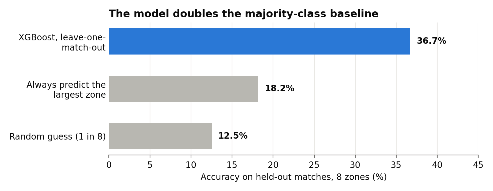
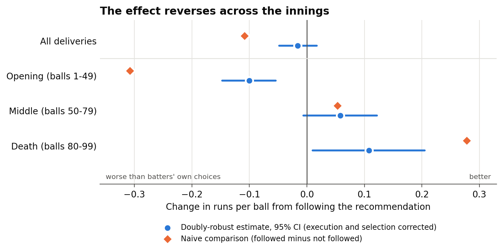
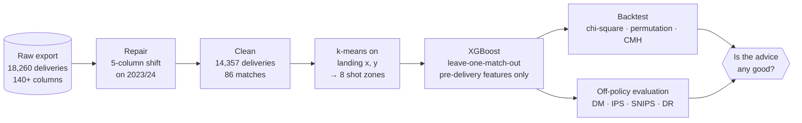
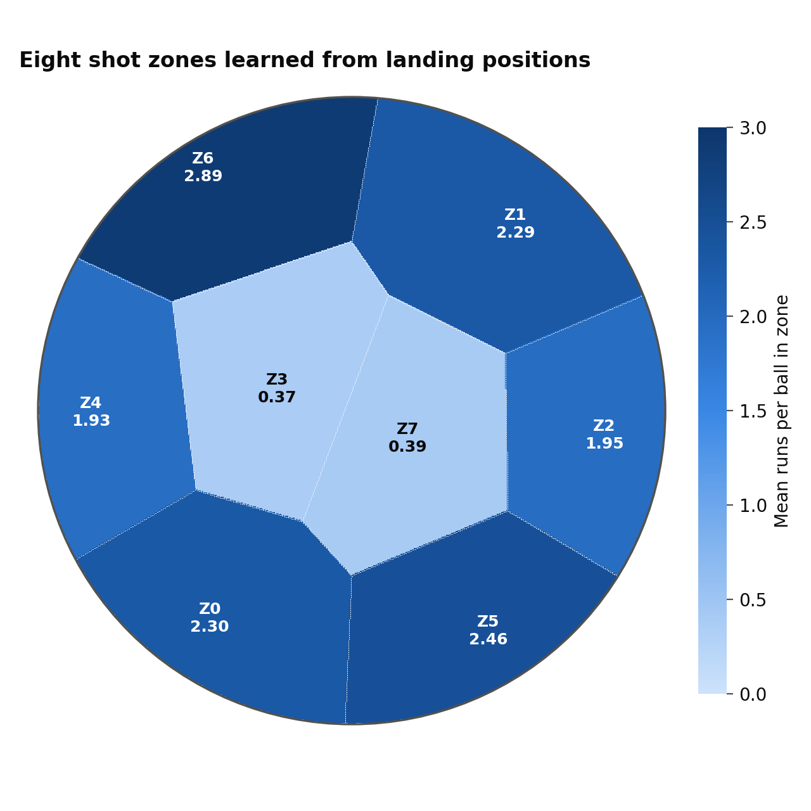

<div align="center">

# 🏏 Predicting Batting Shot Placement in The Hundred

**Where will the ball go, and is that where the batter *should* hit it?**

A machine learning pipeline that learns shot zones from ball-tracking data, predicts where each delivery will be played, and then tests whether following those predictions would actually score more runs.

[](https://www.python.org/)
[](https://xgboost.readthedocs.io/)
[](https://scikit-learn.org/)
[](https://www.statsmodels.org/)
[](https://github.com/YOUR-GITHUB-USERNAME/hundred-shot-placement/actions/workflows/tests.yml)
[](LICENSE)

MSc Data Science dissertation · University of Sussex · 2026

[Key findings](#-key-findings) · [How it works](#-how-it-works) · [Data quality](#-the-data-quality-story) · [Results](#-results-in-detail) · [Quickstart](#-quickstart) · [Repo layout](#-repository-layout)

</div>

---

> [!IMPORTANT]
> **The short version.** An XGBoost model predicts which of eight shot zones a delivery will be played into with **36.7% accuracy**, double the 18.2% majority-class baseline, on matches it has never seen. But batters who played into the predicted zone scored **fewer** runs, not more. The reason is that the model learned what batters *usually* do, which against a good ball is defend. Once decision quality is separated from execution, the recommendation hurts in the first half of the innings and helps in the last 20 balls. A model can be accurate and still give poor advice.

<table>
<tr>
<td align="center"><b>18,260</b><br/><sub>deliveries, 3 seasons</sub></td>
<td align="center"><b>12,361</b><br/><sub>rows recovered from a<br/>silent export defect</sub></td>
<td align="center"><b>36.7%</b><br/><sub>accuracy on 8 zones<br/>(baseline 18.2%)</sub></td>
<td align="center"><b>85</b><br/><sub>leave-one-match-out<br/>folds</sub></td>
<td align="center"><b>-0.10 → +0.11</b><br/><sub>runs per ball, opening<br/>vs death overs</sub></td>
</tr>
</table>

<picture>
  <source media="(prefers-color-scheme: dark)" srcset="docs/figures/accuracy-dark.png">
  
</picture>

## 🎯 The question

Ball-tracking systems record the release, trajectory, bounce and landing point of every delivery in professional cricket. Most of that data is used to describe what already happened: wagon wheels, pitch maps, strike rates by phase.

This project asks a different question, the one a batting coach faces at a drinks break: **where should the batter aim next?** The Hundred suits this well. Innings last exactly 100 balls, and there is a natural break every ten deliveries where a short, clear instruction could be passed on.

| | Research question | Answer |
|---|---|---|
| **RQ1** | Can a model predict the shot zone from pre-delivery information, meaningfully above a naive baseline? | ✅ **Yes.** 36.7% vs 18.2%, stable across matches (SD 4.6 points). |
| **RQ2** | Which features matter, and do fielder positions help? | 🟡 **Partly.** Batting hand leads. Fielders carry 14.5% of model gain, but only exist for 2025, so a season effect cannot be ruled out. |
| **RQ3** | Is following the recommendation associated with more runs, across phases and bowler types? | ❌ **No overall, and not consistently.** Negative early, neutral in the middle, positive at the death. |

## 💡 Key findings

### 1. Accurate is not the same as useful

Deliveries played into the recommended zone scored **1.537** runs per ball against **1.646** for the rest. Following the recommendation came with more dot balls (30.6% vs 22.7%) and fewer fours. Only 27 of 85 matches favoured following it.

The model is trained to predict where the ball *went*. Against a well-directed delivery the most likely outcome is a defensive shot into a central zone, so the model predicts exactly that, the batter does exactly that, and nobody scores. **It learned the most likely shot, not the best one.**

### 2. The effect reverses across the innings, and survives correction

If that explanation is right, the recommendation should look best when the most likely shot is also an aggressive one, which is the death overs. That is what the data shows. It still holds after a doubly-robust off-policy correction that separates the quality of the decision from how well the shot was executed.

<picture>
  <source media="(prefers-color-scheme: dark)" srcset="docs/figures/phase-reversal-dark.png">
  
</picture>

| Phase | Naive difference | Doubly-robust uplift | 95% CI (match bootstrap) |
|---|---:|---:|---|
| All deliveries | -0.108 | **-0.016** | [-0.048, +0.017] |
| Opening (balls 1-49) | -0.308 | **-0.100** | [-0.147, -0.054] |
| Middle (balls 50-79) | +0.053 | **+0.058** | [-0.006, +0.122] |
| Death (balls 80-99) | +0.278 | **+0.108** | [+0.010, +0.205] |

<sub>Runs per ball, following the recommendation minus the batters' own choices. The correction removes about 85% of the pooled deficit and makes it non-significant, but keeps the phase ordering.</sub>

### 3. Fixing the data changed the model more than any modelling choice

Two thirds of the dataset had every ball-tracking value in the wrong column. Repairing it moved the apparent top feature from **1st to 15th** and brought five discarded columns into the top 20. See [the data quality story](#-the-data-quality-story).

### 4. The practical fix is already inside the model

The classifier outputs a full probability for every zone. Recommending the zone with the highest **expected runs** (probability × zone value) rather than the highest probability turns a descriptive model into a prescriptive one without retraining. This repo includes that recommender with a sample-split evaluation that avoids scoring it with the same numbers used to choose it ([`recommend.py`](src/shotzones/recommend.py)).

> [!NOTE]
> This is the dissertation's main idea: **the gap between predicting what happens and recommending what should happen**. It is not specific to cricket. Any team turning an outcome-prediction model into a recommendation system runs into it.

## ⚙️ How it works



| Stage | Method | Why this choice |
|---|---|---|
| **Target** | k-means (k = 8) on standardised landing coordinates | Zones come from where batters actually hit the ball, not from named fielding positions |
| **Features** | Ball tracking, delivery type, match state, batting hand, fielder positions | Only information available *before* the ball is played |
| **Model** | XGBoost, 300 trees, depth 5, untuned | Strong on tabular data, handles the sentinel-coded fielder columns, interpretable |
| **Validation** | Leave-one-match-out (85 folds) | Deliveries within a match share pitch, teams and state; random splits can leak |
| **Inference** | Permutation chi-square and Cochran-Mantel-Haenszel, stratified by match | Runs are discrete (0/1/2/3/4/6) and deliveries cluster within matches |
| **Policy value** | Doubly-robust off-policy evaluation, cluster bootstrap CIs | Separates decision quality from execution and corrects for which balls happened to follow the advice |

<picture>
  <source media="(prefers-color-scheme: dark)" srcset="docs/figures/zone-map-dark.png">
  
</picture>

<sub>Zone regions drawn from the published cluster centres (Table 5.2), so boundaries are approximate. No delivery-level data is shown.</sub>

## 🔧 The data quality story

This was the most consequential part of the project, and it was found by accident.

<details open>
<summary><b>Three defects, in the order they were discovered</b></summary>
<br/>

| # | What it looked like | What it actually was | Fix |
|---|---|---|---|
| 1 | Fielder coordinate columns containing the text `Kookaburra` and `White` | A symptom of defect 3. Fielder data for 2023/24 was never there | Documented; fielder features treated as 2025-only |
| 2 | A central "straight hitting" zone | 1,798 deliveries with **no bat contact** carrying the wicketkeeper's position as a landing point. They made up 47% of that zone | One extra cleaning filter; zones re-derived |
| 3 | 72% of `ImpactX` missing; odd feature importances | Every 2023 and 2024 row (**12,361 deliveries**) exported with five extra columns inserted at position 105, pushing every later value five columns right | Shift the tail of affected rows back five places |

</details>

**How the shift was proven, not assumed.** Three independent fingerprints line up exactly:

1. The `Ball Type` / `Ball Colour` text appears in fielder columns on exactly the 12,361 affected rows and on none of the 5,899 others.
2. On affected rows, `BounceSpeed`, `StumpSpeed` and `DropSpeed` hold values identical to `ReleaseX/Y/Z` on 100% of rows, which pins the insertion point.
3. The boundary between affected and clean rows is exactly the 2024/2025 season boundary.

After repair, the two export eras agree: `SwingAngle` medians 0.146 vs 0.133, `DropAngle` -13.90 vs -13.82.

| Effect of the repair | Before | After |
|---|---:|---:|
| `ImpactX` populated | 27.9% | 83.9% |
| `ReleaseAngle` importance rank | **1st** (0.0927) | 15th (0.0122) |
| Recovered columns in the top 20 features | 0 | 5 (`PastY` 2nd, `ImpactX` 4th, `ImpactY` 6th, `ImpactZ` 9th, `PastZ` 18th) |

> [!TIP]
> The repair is reproduced end to end on the synthetic sample. The generator in [`synthetic.py`](src/shotzones/synthetic.py) recreates the same defect, [`repair.py`](src/shotzones/repair.py) fixes it, and [`tests/test_repair.py`](tests/test_repair.py) checks the repaired values match a defect-free export exactly.

## 📊 Results in detail

<details>
<summary><b>Model performance</b> (Table 5.4 and 5.7)</summary>
<br/>

| Metric | Value |
|---|---:|
| Accuracy (LOMO, 85 matches, 14,342 deliveries) | **0.367** |
| Weighted F1 | 0.363 |
| Macro F1 | 0.344 |
| Mean per-match accuracy (SD) | 0.366 (0.046) |
| Majority-class baseline | 0.182 |
| Random guess | 0.125 |

| Cross-validation scheme | Accuracy | Weighted F1 |
|---|---:|---:|
| Random 5-fold (delivery level) | 36.69% | 0.362 |
| Grouped 5-fold (by match) | 36.76% | 0.362 |
| Leave-one-match-out | 36.72% | 0.363 |

All three agree within 0.07 points. Match, venue, team and bowler identifiers had already been removed, which closes the usual route for match-level leakage.

</details>

<details>
<summary><b>The minority zone problem</b> (Section 5.4.1, grouped 5-fold)</summary>
<br/>

Zone 6 is the highest-scoring zone (2.89 runs per ball) and has the lowest dismissal rate, but the model recalls only 15% of it. Class weighting helps at a small cost:

| Weighting | Accuracy | Macro F1 | Zone 6 recall | Zone 6 precision |
|---|---:|---:|---:|---:|
| None | 0.368 | 0.343 | 0.146 | 0.378 |
| Square root | 0.365 | 0.349 | 0.187 | 0.321 |
| Balanced | 0.357 | 0.348 | **0.261** | 0.277 |

</details>

<details>
<summary><b>Backtest hypothesis tests</b> (Table 5.11)</summary>
<br/>

| Test | Statistic | p | Effect |
|---|---:|---:|---|
| Chi-square, 2 × 6 (naive, ignores clustering) | 135.9 | < 0.000001 | Cramér's V = 0.097 |
| Permutation chi-square (shuffled within match) | 135.9 | 0.0005 | |
| CMH, boundary vs not | 3.59 | 0.058 | OR 0.922 [0.847, 1.003] |
| CMH, scoring shot vs dot | 104.6 | < 0.000001 | OR 0.669 [0.620, 0.723] |

The naive test is about three orders of magnitude overconfident, which is why it is shown only as a reference. Breslow-Day tests (p = 0.029 and 0.024) say the effect varies between matches, consistent with the phase pattern.

</details>

<details>
<summary><b>Off-policy estimators</b> (Table 5.16)</summary>
<br/>

| Estimator | Runs per ball |
|---|---:|
| Behaviour policy (batters' own choices) | 1.606 |
| Direct method | 1.544 |
| Inverse propensity scoring | 1.407 |
| Self-normalised IPS | 1.581 |
| **Doubly robust** | **1.590** |

For deterministic target policy $\pi$, behaviour propensities $\mu$ from out-of-fold probabilities, and a reward model $\hat r$ cross-fitted by match:

$$\hat V_{DR} = \frac{1}{n}\sum_{i=1}^{n}\left[\hat r\big(x_i, \pi(x_i)\big) + \frac{\mathbf{1}\{a_i = \pi(x_i)\}}{\mu(a_i \mid x_i)}\big(r_i - \hat r(x_i, a_i)\big)\right]$$

</details>

<details>
<summary><b>Robustness to the number of zones</b> (Table 5.15)</summary>
<br/>

| | k = 7 | k = 8 |
|---|---:|---:|
| Accuracy | 0.418 | 0.367 |
| Improvement over own baseline | +0.136 | **+0.185** |
| Odds ratio, opening | 0.557 | 0.766 |
| Odds ratio, middle | 0.773 | 1.038 |
| Odds ratio, death | 1.017 | 1.281 |

The direction of the phase pattern holds at both values. The size of the death-overs effect does not, so that claim is made with a caveat.

</details>

## ⚠️ Limitations

Being clear about these is part of the result.

- **Correlational, not causal.** Better batters find gaps more often, so "followed" partly measures batter quality. The doubly-robust estimate reduces this but cannot condition on intent the data does not record.
- **Survivorship in dismissal rates.** A boundary attempt caught at deep midwicket is recorded where it was caught, not where it was aimed. Low risk in boundary zones is risk *given the ball got there*.
- **Fielder data only for 2025**, and only on a third of those deliveries, so RQ2 cannot separate fielder information from a season effect. A 2025-only ablation is included in the code.
- **Hyperparameters were not tuned.** Tuning properly under leave-one-match-out needs nested CV. The accuracy is a reasonable figure, not an optimised one.
- **One competition.** Men's Hundred only. Zones and models would need re-estimating for T20 or longer formats.

## 🔭 What I would do next

1. **Evaluate the expected-value recommender on the real data.** The code is here; the sample-split design stops the zone values that choose a recommendation from also grading it.
2. **Estimate the accuracy ceiling.** Near-identical deliveries played to different zones would show how much of the 63% error is irreducible.
3. **Top-3 accuracy and simpler baselines.** A coach can use a shortlist, and logistic regression would show whether boosting is earning its complexity.
4. **Batter-specific models,** so an unusual but effective player is not scored against the average batter.

## 🚀 Quickstart

```bash
git clone https://github.com/YOUR-GITHUB-USERNAME/hundred-shot-placement.git
cd hundred-shot-placement
python -m venv .venv && source .venv/bin/activate    # Windows: .venv\Scripts\activate
pip install -e ".[dev]"

# Run the full pipeline on the synthetic sample (about 90 seconds)
python -m shotzones.pipeline --out outputs

# Or a quick check (about 30 seconds)
python -m shotzones.pipeline --fast --out outputs

# Tests
pytest
```

Results land in `outputs/RESULTS.md` with tables and figures. A complete example run is committed in [`examples/synthetic_run/`](examples/synthetic_run/RESULTS.md), and [`notebooks/walkthrough.ipynb`](notebooks/walkthrough.ipynb) steps through every stage with outputs.

> [!WARNING]
> **The real data is not in this repository.** It was supplied by Hampshire Cricket Club under an agreement that does not allow redistribution. The pipeline runs on a synthetic sample with the same columns and the same data defects. Numbers from the synthetic sample describe invented cricket. Every result quoted in this README comes from the dissertation, run on the real data. See [`data/README.md`](data/README.md).

<details>
<summary><b>Running on the real export</b></summary>
<br/>

If you have legitimate access to the data:

```bash
python -m shotzones.pipeline --data path/to/export.xlsx --out outputs_real
```

The first thing the pipeline writes is `01_cumulative_timing_check.csv`, which confirms that running totals (batter runs, team runs) are recorded before the ball rather than after it. If either is post-ball, convert it with `features.to_pre_delivery()` before trusting the model.

The refactored pipeline makes a few deliberate corrections to the original notebook: an explicit feature allowlist, imputation learned inside each training fold, and the 100th ball kept in phase tables. A rerun on the real data may therefore differ slightly from the figures above.

</details>

## 🗂️ Repository layout

```
hundred-shot-placement/
├── src/shotzones/
│   ├── config.py         # every setting that shaped a result, in one place
│   ├── synthetic.py      # synthetic data with the real schema and defects
│   ├── repair.py         # detect and reverse the 5-column export shift
│   ├── cleaning.py       # sequential filters with a row-count audit log
│   ├── zones.py          # k-means shot zones and k selection
│   ├── features.py       # allowlisted features, per-fold imputation, leakage checks
│   ├── model.py          # XGBoost, leave-one-match-out and k-fold CV, ablations
│   ├── backtest.py       # chi-square, within-match permutation, CMH, Breslow-Day
│   ├── ope.py            # reward model, DM / IPS / SNIPS / DR, cluster bootstrap
│   ├── recommend.py      # expected-value recommender with sample-split evaluation
│   ├── plots.py          # pipeline figures
│   └── pipeline.py       # end-to-end CLI
├── tests/                # repair, cleaning, leakage, estimator and smoke tests
├── notebooks/walkthrough.ipynb
├── examples/synthetic_run/   # committed output of a full run
├── data/sample/          # synthetic raw export (2,442 rows)
├── docs/figures/         # README charts, drawn from published aggregates only
└── scripts/              # figure and notebook builders
```

## 🧰 Built with

`Python` · `pandas` · `NumPy` · `scikit-learn` · `XGBoost` · `SciPy` · `statsmodels` · `Matplotlib` · `pytest` · `GitHub Actions`

## 📄 About

**Dissertation:** *Predicting Batting Shot Placement in The Hundred: Expected Zones versus Actual Outcomes*, MSc Data Science, University of Sussex, August 2026. Supervised by James Van Yperen.

**Author:** David Sinclair · [LinkedIn](https://www.linkedin.com/in/YOUR-LINKEDIN) · [Website](https://YOUR-WEBSITE)

Thanks to Hampshire Cricket Club for access to the ball-by-ball data, and to James Van Yperen for repeatedly asking exactly what was being measured and how.

Code is released under the [MIT License](LICENSE). The data is not.
