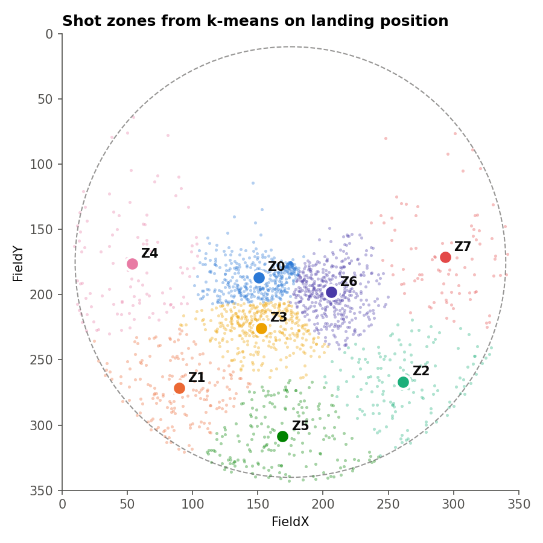
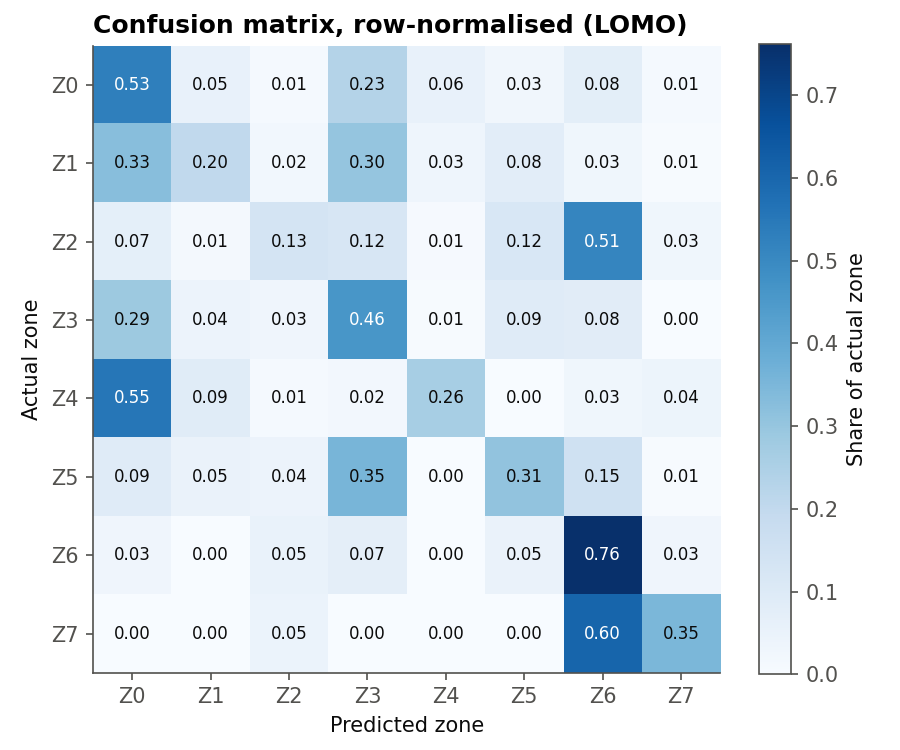
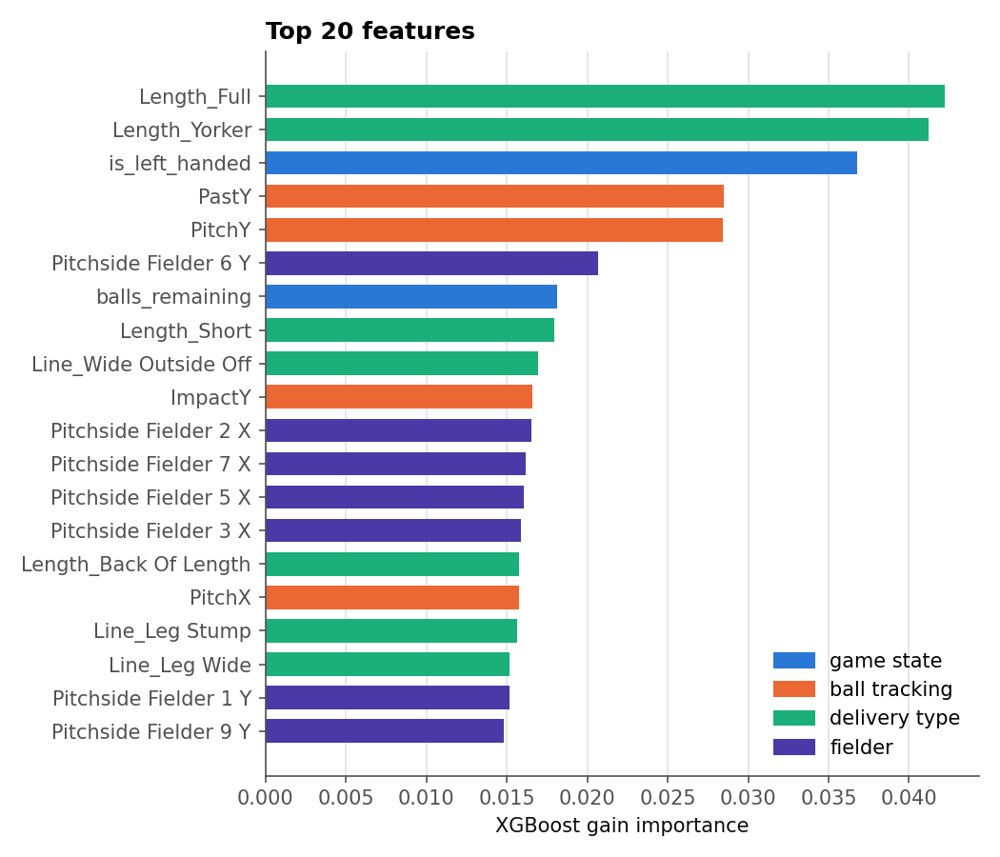
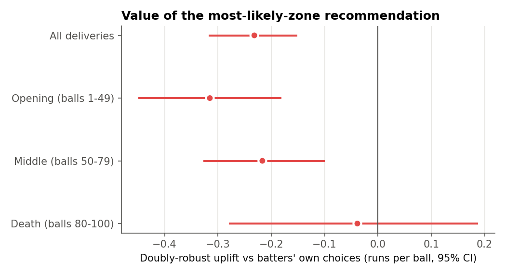

# Pipeline results

Data: `data/sample/synthetic_raw.csv`

> [!WARNING]
> If this was run on the synthetic sample, these numbers describe invented data and
> say nothing about The Hundred. The dissertation's results are in the main README.

## Data repair

- Rows repaired: **1,630**
- Ball Type restored on repaired rows: 100.0%
- Sentinel values remaining after repair: 0

### Running-total timing check

| column                 |   pre_ball_share |   post_ball_share |   rows_checked | verdict         |
|:-----------------------|-----------------:|------------------:|---------------:|:----------------|
| Cumulative Batter Runs |         0.975758 |          0.333766 |           2310 | pre-ball (safe) |
| Team Runs              |         1        |          0.31555  |           2418 | pre-ball (safe) |

## Cleaning

| Step | Rows remaining | Removed |
|---|---:|---:|
| Raw dataset | 2,442 |  |
| Legal deliveries only | 2,333 | 109 |
| Drop null FieldX / FieldY (target) | 2,216 | 117 |
| Drop null core delivery features | 2,216 | 0 |
| Drop null Shot | 2,205 | 11 |
| Remove not-hit deliveries | 1,931 | 274 |
| Drop null SwingAngle / DropAngle | 1,928 | 3 |
| Drop null Release coordinates | 1,896 | 32 |
| Drop null Speed | 1,896 | 0 |
| Drop null BounceAngle / ReleaseAngle | 1,896 | 0 |
| Drop null Feet | 1,892 | 4 |

## Model (leave-one-match-out)

| Metric | Value |
|---|---:|
| accuracy | 0.4609 |
| weighted f1 | 0.4419 |
| macro f1 | 0.3865 |
| majority baseline | 0.2230 |
| random baseline | 0.1250 |
| improvement over baseline | 0.2378 |
| n deliveries | 1,892 |
| mean match accuracy | 0.4614 |
| sd match accuracy | 0.0467 |
| n matches | 12 |

## Backtest hypothesis tests

| test                                  |   statistic |         p | effect                    |   breslow_day_p |
|:--------------------------------------|------------:|----------:|:--------------------------|----------------:|
| Chi-square (naive, 2 x 6)             |       77.48 | 2.818e-15 | Cramer's V = 0.2024       |       nan       |
| Permutation chi-square (within match) |       77.48 | 0.0004998 |                           |       nan       |
| CMH, boundary vs not                  |       40.05 | 2.473e-10 | OR = 0.379 [0.278, 0.517] |         0.1762  |
| CMH, scoring shot vs dot              |       15.7  | 7.423e-05 | OR = 0.680 [0.562, 0.824] |         0.02965 |

## Backtest by phase

| phase                |   n |   runs_followed |   runs_not_followed |   bnd_pct_followed |   bnd_pct_not_followed |   odds_ratio |   ci_low |   ci_high |     p |   strata |
|:---------------------|----:|----------------:|--------------------:|-------------------:|-----------------------:|-------------:|---------:|----------:|------:|---------:|
| Opening (balls 1-49) | 938 |           0.630 |               1.435 |              0.930 |                 15.748 |        0.054 |    0.020 |     0.147 | 0.000 |       12 |
| Middle (balls 50-79) | 595 |           0.725 |               1.327 |              2.143 |                 14.921 |        0.117 |    0.049 |     0.278 | 0.000 |       12 |
| Death (balls 80-100) | 359 |           2.228 |               1.853 |             31.481 |                 20.812 |        1.738 |    1.075 |     2.809 | 0.021 |       12 |

## Off-policy evaluation

| group                |        n |   behaviour |    DM |   IPS |   SNIPS |    DR |   DR_uplift |   uplift_ci_low |   uplift_ci_high |
|:---------------------|---------:|------------:|------:|------:|--------:|------:|------------:|----------------:|-----------------:|
| All deliveries       | 1892.000 |       1.240 | 0.987 | 0.736 |   0.984 | 1.009 |      -0.232 |          -0.317 |           -0.152 |
| Opening (balls 1-49) |  938.000 |       1.066 | 0.764 | 0.484 |   0.662 | 0.751 |      -0.315 |          -0.449 |           -0.181 |
| Middle (balls 50-79) |  595.000 |       1.044 | 0.796 | 0.557 |   0.737 | 0.827 |      -0.217 |          -0.327 |           -0.099 |
| Death (balls 80-100) |  359.000 |       2.022 | 1.889 | 1.692 |   2.167 | 1.984 |      -0.039 |          -0.280 |            0.188 |

## Most-likely vs expected-value recommendation (sample-split)

| policy                          | group                |        n |   behaviour |    DM |   IPS |   SNIPS |    DR |   DR_uplift |   uplift_ci_low |   uplift_ci_high |   share_matching_play |
|:--------------------------------|:---------------------|---------:|------------:|------:|------:|--------:|------:|------------:|----------------:|-----------------:|----------------------:|
| Most likely zone (dissertation) | All deliveries       | 1892.000 |       1.240 | 0.978 | 0.736 |   0.984 | 1.007 |      -0.233 |          -0.316 |           -0.151 |                 0.461 |
| Most likely zone (dissertation) | Opening (balls 1-49) |  938.000 |       1.066 | 0.778 | 0.484 |   0.662 | 0.747 |      -0.319 |          -0.453 |           -0.181 |                 0.458 |
| Most likely zone (dissertation) | Middle (balls 50-79) |  595.000 |       1.044 | 0.817 | 0.557 |   0.737 | 0.827 |      -0.216 |          -0.323 |           -0.106 |                 0.471 |
| Most likely zone (dissertation) | Death (balls 80-100) |  359.000 |       2.022 | 1.767 | 1.692 |   2.167 | 1.985 |      -0.037 |          -0.287 |            0.189 |                 0.451 |
| Expected-value zone (extension) | All deliveries       | 1892.000 |       1.240 | 1.348 | 1.151 |   1.566 | 1.494 |       0.254 |           0.192 |            0.325 |                 0.399 |
| Expected-value zone (extension) | Opening (balls 1-49) |  938.000 |       1.066 | 1.131 | 0.780 |   1.200 | 1.222 |       0.156 |           0.015 |            0.312 |                 0.375 |
| Expected-value zone (extension) | Middle (balls 50-79) |  595.000 |       1.044 | 1.222 | 1.044 |   1.369 | 1.349 |       0.305 |           0.194 |            0.435 |                 0.402 |
| Expected-value zone (extension) | Death (balls 80-100) |  359.000 |       2.022 | 2.124 | 2.296 |   2.519 | 2.445 |       0.423 |           0.234 |            0.607 |                 0.457 |

